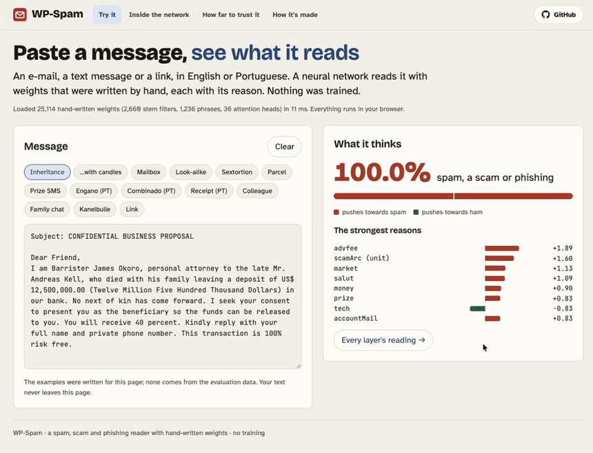

# WP-Spam

A neural network for spam, scams and phishing whose weights were **written by hand**, not trained. One model for e-mail,
SMS and links, in English and Portuguese: 25,114 non-zero weights (110 KB), running in a static page. A fun experiment,
not a production filter.

**Demo:** https://heldernoid.github.io/WP-Spam/ (Try it · Inside the network · How far to trust it · How it's made)



```
text -> tokens
     -> character layer          each character is a vector over letters ("0" is mostly "o", "1" is "i" or "l", Cyrillic
                                  "а" is "a"); 2,660 stem filters convolve over those vectors, at a word's start, over the
                                  whole word, or anywhere inside it. One winning stem per word. So "v1agra", "pаypal",
                                  "ver1fy" and "cheapviagra" reach their concept without a row for each spelling.
     -> letter-pair layer         which letter pairs English and Portuguese words can contain and start with; a word that
                                  cannot be read aloud ("dtowa", "nloa") is a fragment made to slip past filters
     -> embedding                 the winning stem's row over 141 named dims (pharmacy pitch, crypto, sextortion, parcel
                                  fee, colleagues at work, chat between friends, family, plans, news prose, receipt, ...),
                                  1,236 phrases of 2-4 words, token shapes, URL features
     -> attention, layer 1        30 heads: a number next to money is a sum; "click here" next to a link; "within 24 hours";
                                  "you must"; "I went"; "I'll pick you up"; a brand next to account talk; "send BTC to"...
     -> attention, layer 2        6 heads that read layer 1: an offer followed by a link, a threat followed by a link or a
                                  demand to pay, the advance-fee story's money, a plan with a time
     -> pooling                   sum over tokens, then log1p (URL features max-pooled)
     -> sentence layer            each sentence pooled on its own, 10 clamped roles: offer, ask, contact, story, notice,
                                  chat, work, news, threat, life
     -> message layer             role totals, role shares, 7 arcs (offer -> ask -> contact, threat -> ask, ...)
     -> MLP, 3 layers (34 units)  concept neurons (advance fee, phishing, crypto, extortion, job, parcel, tech support,
                                  chatter, life story, prose, gibberish, ...), gates (is there a way to act? ham words in
                                  text that is not prose?), and their combinations
     -> output                    logit -> p(spam), threshold 0.5
```

Where the weights are: the character layer's filters 16,826 (one weight per letter of each stem) and their rows 2,790;
phrases 3,995; URL features and host lists 404; attention 292; MLP 292; letter pairs 204; the rest 309.

Every row, head and unit has its reason in `gen/net.mjs`. No dataset name, sender or address is in the weights.

## Results

Nine public datasets (CEAS-08, Enron, Ling, SpamAssassin, Nazario, Nigerian fraud, Mendeley SMS, a Mozambican
Portuguese SMS set, Hannousse URLs), split once by hash into study / dev / sealed test. Positive = spam or phishing.
The weights were written reading errors on the study split only (58,141 labels); the sealed test was run once on the
finished network (`eval/test-runs.md`).

**Sealed test** (10,351 messages):

| Weights | Labels seen | Non-zero params | Accuracy |
|---|---|---|---|
| **Hand-written** | 58,141 | 25,114 | **89.5%** |
| Trained bag-of-words | 512 | 65,875 | 87.8% |
| Trained bag-of-words | 7,723 | 240,424 | 94.6% |
| Trained bag-of-words | 58,141 | 262,141 | 97.1% |

The trained model is logistic regression on hashed words, word pairs, and URL parts and character 4-grams
(`eval/trained.mjs`), the classic spam filter. Given the same labels it is far ahead.

**By channel** (sealed test, English only):

| | E-mail (6,678) | SMS (1,174) |
|---|---|---|
| **Hand-written** | **90.5%** | **95.7%** |
| Trained, 512 labels | 90.4% | 91.1% |
| Trained, 7,723 labels | 96.3% | 94.2% |
| Trained, 58,141 labels (all channels) | 98.8% | 95.1% |

On SMS the hand-written network is level with the model trained on every channel, because SMS is only 6% of that
model's data. A model trained on English SMS alone (3,504 labels, dev split) reaches 99.0%.

**By source** (sealed test):

| Source | Hand-written | Trained, 58,141 labels |
|---|---|---|
| CEAS (e-mail) | 90.1% | 99.4% |
| Enron (e-mail) | 87.5% | 98.3% |
| Hannousse (links) | 82.5% | 92.5% |
| Ling (e-mail) | 97.2% | 99.6% |
| Mendeley (SMS) | 95.7% | 95.1% |
| Mozambique (SMS, Portuguese) | 90.2% | 96.8% |
| Nazario (phishing) | 87.8% | 96.7% |
| Nigerian fraud | 94.9% | 99.4% |
| SpamAssassin (e-mail) | 91.0% | 98.7% |
| **All** | **89.5%** | **97.1%** |

**Mail of a kind never seen** (`node eval/unseen.mjs`, dev). Each source is left out in turn: the trained model learns
from the other eight, then is scored on it.

| Left-out source | Trained on the other eight | Hand-written |
|---|---|---|
| CEAS | 89.9% | 90.3% |
| Enron | 80.5% | 86.9% |
| Hannousse (links) | 54.0% | 80.8% |
| Ling | 95.2% | 96.3% |
| Mendeley (SMS) | 56.3% | 95.5% |
| Mozambique (SMS, Portuguese) | 40.4% | 91.8% |
| Nazario (phishing) | 57.2% | 90.3% |
| Nigerian fraud | 98.3% | 94.6% |
| SpamAssassin | 93.3% | 92.8% |
| **all, each unseen** | **75.4%** | **89.4%** |

Most of the trained model's 97% is knowledge of these nine sources. The hand-written network is scored as it is, but
its revisions read errors from every source, so for it no source is fully unseen. The clean comparison is the first
draft, written before any label was read: 82.8% against 75.4% (`LOG.md`).

**Word-swap attack** (`node eval/evasion.mjs`, dev). 300 spam messages caught by both models. An attacker repeatedly
replaces the one word whose swap lowers the score most with an invented word. Share still caught:

| Model | 1 swap | 2 swaps | 3 swaps |
|---|---|---|---|
| Trained bag-of-words, 58,141 labels | 97.0% | 96.0% | 92.0% |
| **Hand-written** | 85.3% | 77.3% | 67.7% |

The trained model spreads its evidence over 260,000 weights; the hand-written one concentrates it in a few rows per
concept, so removing its best evidence word by word works. The character layer reaches disguised spellings, not an
unrelated invented word put in their place. This is the main weakness left.

**Its layers with a trained output** (`node eval/compare.mjs dev`). The hand-written layers kept as they are and only
the 176 output weights trained:

| Model | Labels | Dev accuracy |
|---|---|---|
| **Hand-written, every weight** | 58,141 | 89.4% |
| Its layers + trained output | 512 | 89.3% |
| Its layers + trained output | 7,723 | 91.2% |
| Its layers + trained output | 58,141 | 91.3% |
| Trained bag-of-words | 512 | 87.6% |
| Trained bag-of-words | 58,141 | 97.0% |

With 512 labels the hand-written layers beat a bag-of-words model with 65,875 weights: they are a good representation.

**How it got here** (`LOG.md` has every stage):

| Stage | Labels read | Non-zero params | Sealed test |
|---|---|---|---|
| First draft, general knowledge only | 0 | 1,157 | 83.4% |
| One revision | 7,723 | 1,403 | 87.5% |
| Second revision | 58,141 | 1,674 | 88.6% |
| Sentence, message and gate layers | 58,141 | 1,781 | 88.8% |
| **Character layer, 36 heads, 3-layer MLP** | 58,141 | 25,114 | **89.5%** |

Fourteen times the weights bought less than a point. In a trained network every added weight is fitted to the data;
here every added weight is a fact someone has to know and write down.

## Run it

```
node gen/generate.mjs              # weights/spam.json and web/ from gen/net.mjs (fails over 1 MB weights / 2 MB page)
node tests/run.mjs                 # engine, weights, examples, sizes (no dataset needed)
python3 eval/split.py              # rebuild data/ from data/raw (not committed; see the sources above)
node eval/run.mjs dev              # dev totals (dev is never printed message by message)
node eval/run.mjs study --limit 500 --errors ceas ham 20   # read errors, study split only
node eval/why.mjs enron spam 20 --all                       # a sample of study errors with what pushed them
node eval/compare.mjs dev          # against the trained comparisons
node eval/unseen.mjs               # leave-one-source-out
node eval/evasion.mjs              # word-swap attack
cd web && python3 -m http.server   # the page
```

The page is published from `web/` by `.github/workflows/pages.yml`, which copies the current weights and engine in.

## Related

Sister projects whose weights are also written by hand:
[WP-CharNet](https://heldernoid.github.io/WP-CharNet/), a handwriting reader, and
[WP-Ductus](https://heldernoid.github.io/WP-Ductus/), a calligraphy teacher.

Weights and code written by Claude Opus 5.5 (Anthropic) with the project's author. MIT licence.
